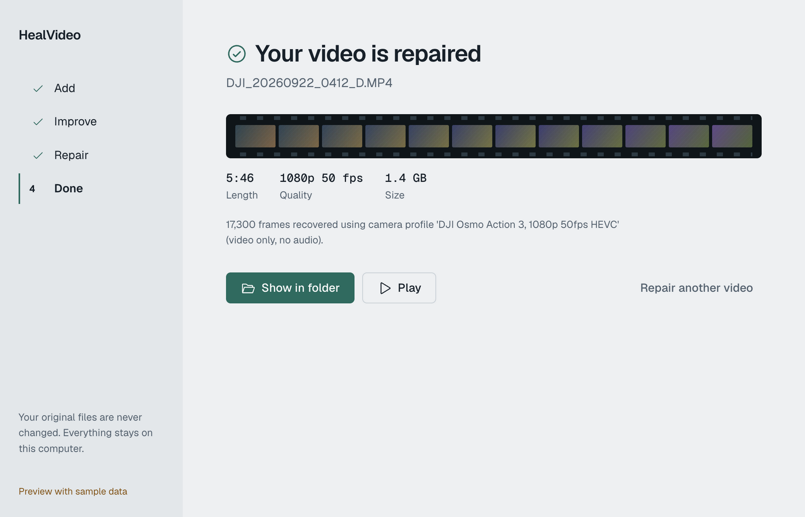
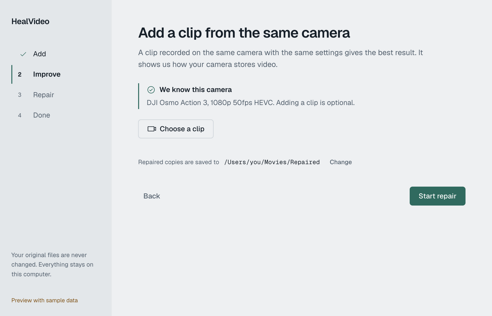
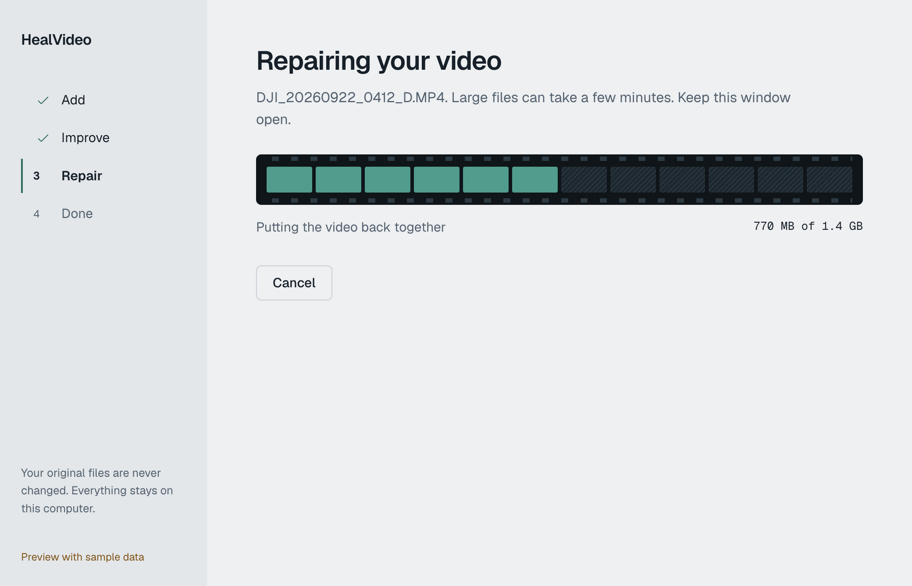

<p align="center">
  
</p>

<h1 align="center">HealVideo</h1>

<p align="center">
  Repair corrupted video files. Free, open source, and your files never leave your computer.
</p>

<p align="center">
  <a href="https://github.com/DhananjayBhosale/healvideo/releases"></a>
  <a href="https://github.com/DhananjayBhosale/healvideo/actions/workflows/ci.yml"></a>
  <a href="LICENSE"></a>
  
</p>

<p align="center">
  <picture>
    <source media="(prefers-color-scheme: dark)" srcset="docs/images/done-dark.png">
    
  </picture>
</p>

> **Early preview (v0.1).** It works on the cases we have tested, and it says so when a repair is only partial.
> See [what is tested](#what-is-tested) before you trust it with the only copy of something.

## Download

Get the file for your computer from the [latest release](https://github.com/DhananjayBhosale/healvideo/releases).

| Your computer | File |
|---|---|
| Mac with Apple chip (M1 or newer) | `HealVideo-mac-arm64.dmg` |
| Mac with Intel chip | `HealVideo-mac-x64.dmg` |
| Windows 10 or 11 | `HealVideo-windows-setup.exe` |
| Linux, any distribution | `HealVideo-linux.AppImage` |
| Debian, Ubuntu, Mint | `HealVideo-linux.deb` |

**Opening it the first time.** Until the installers are signed with a paid publisher certificate, your system may warn you.
On macOS, right-click the app, choose Open, then Open again. On Windows, choose More info, then Run anyway.
Linux needs no step: make the AppImage executable and run it.

## How it works

1. **Add** one or more broken videos. If they come from different cameras, HealVideo keeps the largest group and tells you which files it skipped.
2. **Improve** the result (optional). Add a working clip from the same camera for the best chance. Without one, HealVideo tries anyway, but we can't guarantee it.
3. **Repair.** Watch the film strip fill in as frames come back.
4. **Done.** You get a new file. The original is never changed.

Lost files on a memory card? Choose **Recover from a memory card image** on the first screen. HealVideo rejoins videos that were stored in scattered pieces on an exFAT card.

<p align="center">
  <picture>
    <source media="(prefers-color-scheme: dark)" srcset="docs/images/improve-dark.png">
    
  </picture>
  <picture>
    <source media="(prefers-color-scheme: dark)" srcset="docs/images/repair-dark.png">
    
  </picture>
</p>

<sub>Screenshots use generated sample frames, not anyone's footage.</sub>

## What makes it different

- **Camera profiles.** Decoder settings stored per camera model, so some files can be repaired with no reference clip. One is included (DJI Osmo Action 3). You can [add yours](CONTRIBUTING.md).
- **Frame carver.** When the file's index is gone, it finds the video frames inside the raw data and builds a new file.
- **exFAT chain rebuild.** Rebuilds fragmented videos from a card image, in the right order.
- **Plain-language diagnosis.** It tells you what is wrong ("the recording was cut short", "the index is missing") instead of an error code.
- **Honest results.** Every output is checked by decoding it. Partial results are labelled partial.

## What is tested

| | Status |
|---|---|
| Repair engine | 31 automated tests, passing on Python 3.9 and 3.12 |
| macOS app | Built and launched on one Mac. The `.dmg` has been tested only after the first release build. |
| Windows and Linux apps | Built by GitHub Actions. **Not yet run by a person.** Reports are welcome. |
| exFAT rebuild | Used on one real 64 GB card (115 videos rebuilt). Not yet run through the app window on a full card. |
| Camera profile repair | One camera (DJI Osmo Action 3) on one real clip |
| Not built yet | H.264 carving, FAT32 cards, audio when carving |

Your original files are opened read-only. Nothing is sent anywhere.

## Command line

Needs Python 3.9+ and FFmpeg. [untrunc](https://github.com/anthwlock/untrunc) is optional.

```bash
python -m healvideo doctor                       # check tools
python -m healvideo diagnose broken.mp4
python -m healvideo repair broken.mp4 --out repaired
python -m healvideo repair broken.mp4 --reference good_clip_same_camera.mp4
python -m healvideo rebuild-image card.img --out rebuilt
python -m healvideo profile-make good.mp4 --name "Camera, mode" --match "text in its files"
```

## Build it yourself

```bash
python -m venv .venv && .venv/bin/pip install -e ".[dev,build]"
python -m pytest
cd app && npm install && npm start      # run the app
```

Installer steps and signing are in [docs/RELEASING.md](docs/RELEASING.md). Design notes are in [docs/ARCHITECTURE.md](docs/ARCHITECTURE.md).

## Credits and license

HealVideo is GPL-3.0-or-later. It runs [FFmpeg](https://ffmpeg.org) and builds on ideas from several repair projects, including untrunc.
Everything and everyone we use is listed in [CREDITS.md](CREDITS.md).
